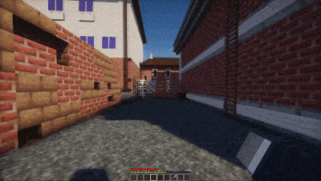
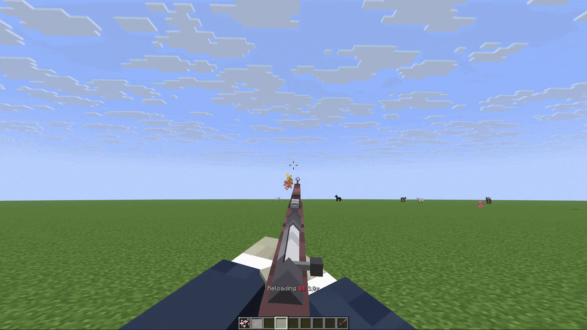

# 🔫 WeaponMechanics

Armature détecte WeaponMechanics comme un fournisseur d’objets et d’actions optionnel. WeaponMechanics reste propriétaire de l’identité de l’arme, des munitions, de la logique de rechargement, du mode de tir, de la visée, des dégâts et des temps de rechargement. Armature traduit ces événements en actions de présentation à la première personne et en signaux de profil modernes.

L’identifiant du fournisseur et l’espace de nom sont `weaponmechanics`.

<figure><figcaption></figcaption></figure>

## Profil moderne

Corrélez le titre WeaponMechanics avec le sélecteur d’objet nommé dans l’espace de nom :

```yaml
m4a1:
  match:
    item: weaponmechanics:m4a1
  model:
    name: arm_rifle
    hide-vanilla-hand: true
  integrations:
    weaponmechanics:
      attachments:
        optic:
          bones:
            scope:
              visible: true
              offset: [0.0, 0.0, 0.0]
  animations:
    actions:
      - trigger: weaponmechanics:fire
        animation:
          name: fire
          duration: 4t
      - trigger: weaponmechanics:reload-start
        animation:
          name: reload
          duration: 20t
```

Le sélecteur d’objet WeaponMechanics est le titre de l’arme, pas le nom d’affichage. Le fournisseur émet des métadonnées de la main sous la forme `main_hand` ou `off_hand`.

La section optionnelle `integrations.weaponmechanics.attachments` contient des identifiants d’accessoires arbitraires. Chaque accessoire contient uniquement `bones`. Chaque os accepte `visible` et `offset`. Un décalage est soit une liste de trois nombres, soit une section `x`/`y`/`z` :

```yaml
integrations:
  weaponmechanics:
    attachments:
      suppressor:
        bones:
          muzzle:
            visible: false
            offset:
              x: 0.0
              y: 0.0
              z: -0.1
```

## Actions et signaux du fournisseur

Le fournisseur émet ces actions de présentation :

| Événement | Action d’Armature | Signal nommé dans l’espace de nom |
| ------------------------- | ----------------------- | -------------------------------------------------- |
| Arme équipée | `EQUIP` | `weaponmechanics:equip` |
| Arme dééquipée | `UNEQUIP` | `weaponmechanics:unequip` |
| Visée entrée | `AIM_ENTER`, puis `AIM` | `weaponmechanics:aim-enter`, `weaponmechanics:aim` |
| Visée reste empilée | `AIM` | `weaponmechanics:aim` |
| Visée sortie | `AIM_EXIT` | `weaponmechanics:aim-exit` |
| Arme tirée depuis la ceinture | `FIRE` | `weaponmechanics:fire` |
| Tir effectué en visant | `AIM_FIRE` | `weaponmechanics:aim-fire` |
| Entrée de rechargement | Signal uniquement | `weaponmechanics:reload` |
| Cycle de rechargement commence | `RELOAD_START` | `weaponmechanics:reload-start` |
| Itération de rechargement | `RELOAD_PHASE` | `weaponmechanics:reload-phase` |
| Le rechargement atteint la capacité | `RELOAD_COMPLETE` | `weaponmechanics:reload-complete` |
| Le rechargement est annulé | `RELOAD_CANCEL` | `weaponmechanics:reload-cancel` |
| L’état de l’arme change | `FIREARM_STATE` | `weaponmechanics:firearm-state-change` |
| Le tir sélectif change | `FIRE_MODE_CHANGE` | `weaponmechanics:fire-mode-change` |

L’adaptateur transporte les métadonnées `main_hand`/`off_hand`. Testez la main émise par votre version installée de WeaponMechanics. Ne déduisez pas à partir du nom du clip.

`weaponmechanics:reload` est envoyé à l’étape d’entrée de priorité basse, avant que WeaponMechanics n’exécute son chemin de rechargement normal. Une règle moderne avec `consume: true` annule l’événement de rechargement de WeaponMechanics. C’est le seul signal fournisseur qui peut empêcher l’action de jeu du fournisseur lui-même. Armature n’implémente toujours pas la logique de rechargement elle-même.

## Détails de l’événement

Chaque événement fournisseur inclut :

| Clé | Valeurs |
| -------------- | ------------------------- |
| `weapon-title` | Titre WeaponMechanics |
| `hand` | `main_hand` ou `off_hand` |

Les événements de portée incluent également `zoom`. L’événement de sortie inclut `automatic-after-shot`. Armature ajoute `aiming=true` ou `aiming=false` au signal moderne correspondant.

Les événements de tir incluent `aiming`.

Les signaux de début de rechargement et de phase incluent :

| Clé | Signification |
| --------------------------------------------------- | ---------------------------------------- |
| `cycle` | ID du cycle de rechargement d’Armature. |
| `phase` | `load`. |
| `ammo`, `ammo-before`, `ammo-after` | Valeurs d’ammunition pour l’itération. |
| `magazine-size` | Capacité actuelle du chargeur. |
| `initial-ammo`, `initial-magazine-size` | Valeurs au début du cycle. |
| `ammo-per-reload` | Calibres chargés par itération. |
| `round-index` | Itération de rechargement à partir de 1. |
| `rounds-needed`, `rounds-added`, `rounds-remaining` | Progression du cycle. |
| `final-round` | Cette itération atteint-elle la capacité. |
| `reload-mode` | `per-round` ou `bulk`. |
| `reload-ticks`, `ammo-load-ticks` | Temps de rechargement WeaponMechanics. |
| `firearm-open-ticks`, `firearm-close-ticks` | Temps de transition d’arme à feu. |
| `firearm-type` | Type d’arme à feu WeaponMechanics normalisé. |

Les rapports de rechargement terminé incluent `cycle`, `rounds-needed`, `rounds-remaining=0` et `final-round=true`. WeaponMechanics peut émettre un événement de complétion après chaque itération `Ammo_Per_Reload`. Armature émet `RELOAD_COMPLETE` uniquement lorsque le chargeur atteint réellement la capacité.

Les rapports d’annulation de rechargement incluent `elapsed-ticks` et, lorsqu’un cycle suivi existe, `cycle`, `rounds-needed` et `rounds-remaining`.

Les signaux d’état des armes à feu incluent : `state`, `firearm-state`, `phase`, `context` (`firearm`, `reload` ou `shot`), `firearm-type`, `time`, `firearm-ticks`, `firearm-open-ticks` et `firearm-close-ticks`.

Les signaux de mode de tir incluent `mode`, `fire-mode`, `old-mode`, `new-mode`, `old-selective-fire` et `new-selective-fire`.

<figure><figcaption><p>Exemple d’action d’arme à feu avec rechargement en plusieurs étapes.</p></figcaption></figure>

## Conditions et exemples

Utilisez les valeurs de fournisseur dans les conditions modernes. Les valeurs de la main droite dynamique nécessitent le préfixe `$` :

```yaml
animations:
  actions:
    - trigger: weaponmechanics:fire
      condition:
        all:
          - weaponmechanics.ammo > 0
          - weaponmechanics.ammo == $weaponmechanics:magazine-size
      animation:
        name: fire
        duration: 4t
```

L’espace de noms du fournisseur est également disponible pour les intégrations via l’API de présentation. Il ne rend pas l’état de jeu modifiable depuis la configuration Armature.

Pour la liste complète des champs intégrés, consultez [Conditions intégrées](../../premiers-pas/profils/conditions.md) et [Déclencheurs intégrés](../../premiers-pas/profils/triggers.md).


## Vérifiez le chemin complet de l’arme

Le titre de l’exemple `m4a1`, les identifiants d’accessoires et les os du modèle doivent exister dans vos propres définitions d’arme/modèle. `arm_rifle` doit fournir `fire` et `reload`. Ajoutez une règle de mouvement `base` pour une pose de repos persistante. Rechargez les profils, reconstruisez et livrez le pack final, puis testez le tir à la hanche, le tir visé, le début du rechargement, chaque phase par tour, la complétion de la capacité, l’annulation et les deux mains.

La surcharge d’attachement d’os WeaponMechanics est séparée des profils composites réutilisables [`type: attachment`](../../premiers-pas/profils/attachments.md). Elle modifie les os configurés. Elle ne définit pas un modèle monté réutilisable.
