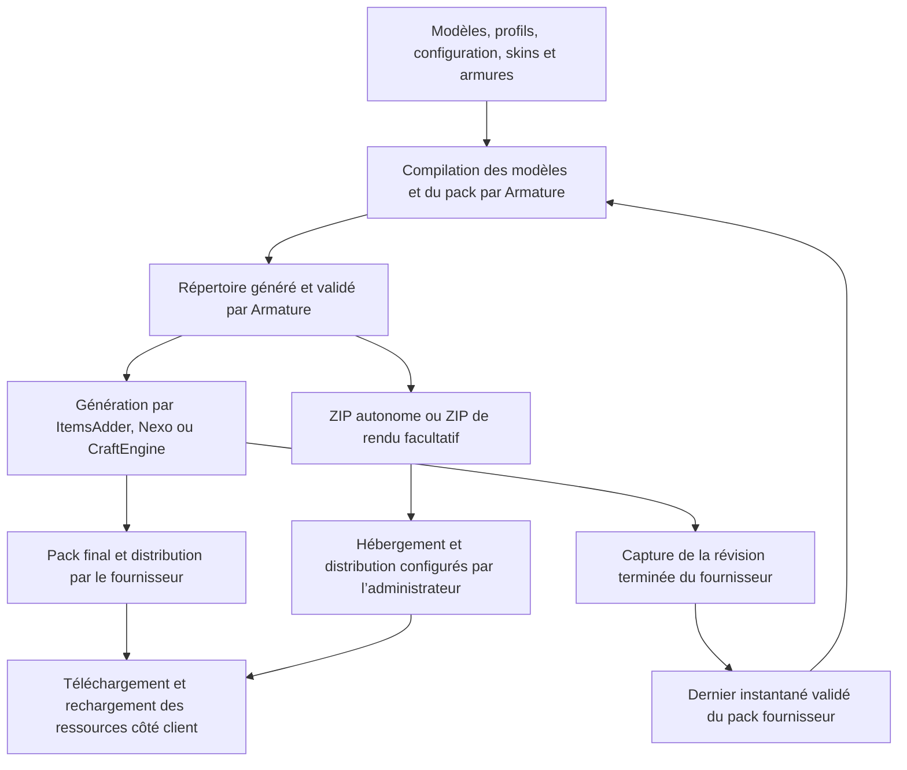

# 📦 Packs de ressources

## Des fichiers créés par l’auteur au pack téléchargé



Le compilateur de modèles lit vos actifs sources et la dernière capture de snapshot validée par le fournisseur. Armature publie un dossier généré. Le fournisseur externe inclut ce dossier lors de sa propre génération, produit un pack final et gère la livraison. Armature capture la sortie du fournisseur **terminée** pour la résolution future des objets-modèles. Un événement de début de génération n’est pas une réception réussie.

Ne modifiez pas `internal/provider-packs/` : il s’agit de captures de snapshot conservées, non de sources d’auteur en direct. Gardez les sources du fournisseur dans les dossiers documentés du fournisseur.

## Générer et synchroniser

1. Appliquez les modifications de modèle/profil/config avec `/armature reload all` ou des commandes ciblées. `/armature reload pack` reconstruit les actifs d’Armature.
2. Demandez la génération CraftEngine/Nexo avec `/armature reload providers`, ou utilisez le flux de génération complet du fournisseur. ItemsAdder conserve sa propre commande de génération.
3. Inspectez `/armature diagnostics startup` et `/armature diagnostics pack` pour le progrès, la complétion et l’état du pack.
4. Livrez le **pack final du fournisseur** et attendez le téléchargement et le rechargement des ressources du client. Validez les actifs réellement téléchargés dans le jeu.

La dernière capture de snapshot validée reste disponible pendant la génération. Les candidats échoués ne deviennent pas des révisions terminées réussies. La réutilisation compare la révision d’Armature et les entrées du fournisseur. Modifier les ressources du fournisseur peut nécessiter une génération même si les modèles d’Armature n’ont pas changé.

## ZIP autonome

`resource-pack.generate-zip: true` écrit également le fichier ZIP Armature. `zip.path`, `zip.method` (`stored`/`deflated`) et le niveau de compression configurent uniquement ce fichier ZIP. Ils ne renomment pas, ne compressent pas ni ne transmettent la sortie finale fournie par un fournisseur externe. Sans fournisseur, hébergez et distribuez le ZIP généré en utilisant la configuration de distribution de pack de votre serveur. La génération Armature seule n’est pas de l’hébergement.

## Pack de ressources pour le moteur de rendu natif optionnel

```yaml
resource-pack:
  renderer-pack:
    enabled: true
    url: "https://packs.example.com/armature/renderer_pack.zip?v={sha1}"
    prompt: "Armature server rendering"
```

Remplacez l’URL d’exemple par votre véritable adresse d’hébergement. Hébergez `plugins/Armature/renderer_pack.zip`, activez la séparation, redémarrez complètement, régénérez et publiez les deux sorties. Le fournisseur continue de distribuer le pack commun (objets personnalisés, sons et autres ressources partagées). Les présentations rendues par le serveur nécessitent le pack de ressources pour le moteur de rendu. Le mod client peut l’omettre tout en rendant un bundle compatible localement. Le retour en arrière attend que le pack de ressources pour le moteur de rendu requis soit prêt.

L’URL est une entrée, non une destination de téléchargement. La mise à jour du ZIP local ne met pas à jour votre hébergeur ; `{sha1}` peut attribuer une URL distincte à chaque révision de contenu.

## Collisions et exclusions

`collision-policy` choisit une propriété déterministe lorsque les chemins normalisés entrent en collision : `keep-existing` conserve le premier propriétaire externe, `replace` laisse le contenu Armature généré gagner là où cela s’applique, et `error` abandonne le candidat. `collision-rules` peut limiter la politique par source, espace de noms et chemin.

`exclusions.sources`, `namespaces` et `paths` filtrent les entrées pour la génération Armature. Elles ne suppriment pas les actifs livrés indépendamment par un autre fournisseur dans son pack final. Les identifiants de source et d’espace de noms sont normalisés en minuscules. Les chemins utilisent des barides obliques, `*` pour un segment et `**` pour plusieurs segments. Les exclusions d’optimisation désactivent uniquement l’optimisation. Elles n’excluent pas l’actif lui-même.

## Validation, optimisation et superpositions

`validation.enable` active les vérifications de modèle/texture/atlas. `fail-on-error` contrôle le rejet des candidats. Examinez les avertissements même si c’est faux. L’optimisation JSON et PNG est facultative et dispose de ses propres listes d’exclusion. `supported-version.min/max` sélectionne les superpositions intégrées. Il ne traduit pas des modèles arbitraires, n’installe pas un mod client pour une autre version, ni ne prolonge l’API du serveur.

Le fournisseur `pack.mcmeta` et les superpositions applicables sont conservés lors de l’intégration. Seules les superpositions actives pour la version de Minecraft en cours participent à la résolution des objets. Les collisions de chemin/superposition dépendent de la fusion finale du fournisseur, donc testez avec d’autres packs activés.

## Diagnostic de livraison

Comparez la révision du modèle/configuration d’entrée, la sortie générée par Armature, le reçu de complétion/final ZIP du fournisseur, le hachage du contenu hébergé et le téléchargement client. Un résultat de compilateur correct peut toujours manquer du pack final du fournisseur ou du ZIP en cache du client. Consultez les pages individuelles [des fournisseurs](../avance/plugins-pris-en-charge/README.md).
