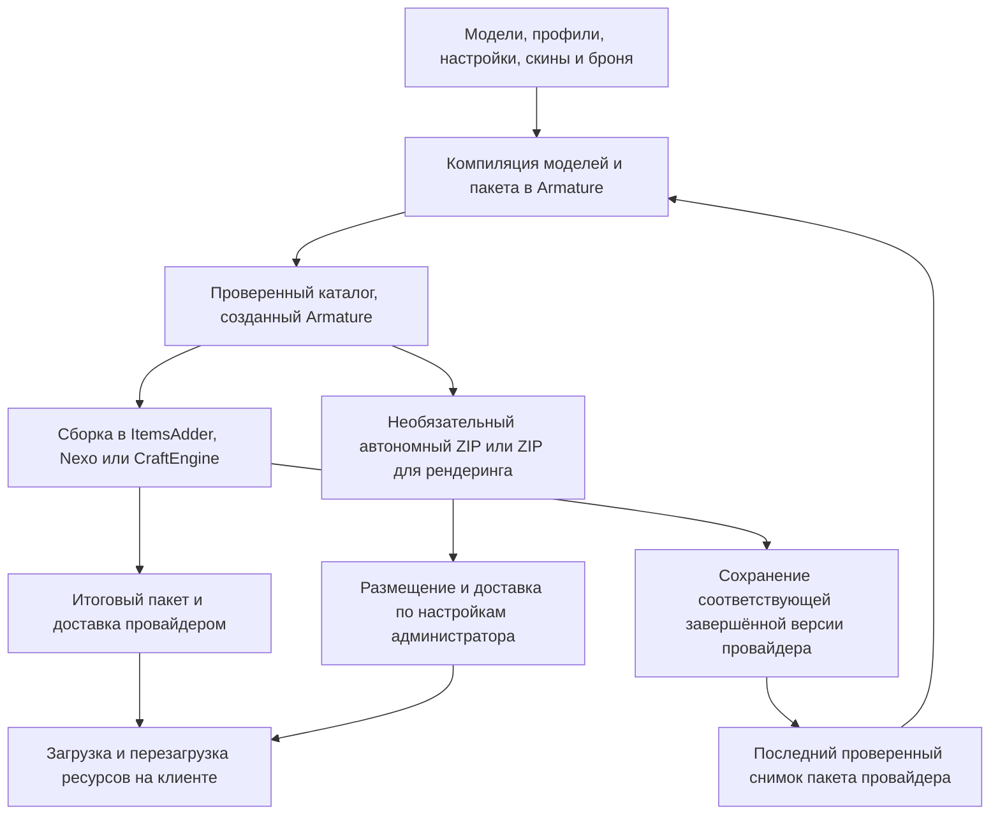

# 📦 Пакеты ресурсов

## От авторских файлов к скачанному пакету



Компилятор моделей читает ваши исходные активы и последнюю валидную версию провайдера. Armature публикует сгенерированную директорию. Внешний провайдер включает эту директорию в свой процесс генерации, создаёт финальный пакет и отвечает за его доставку. Armature сохраняет **завершённый** вывод провайдера для будущей разрешения моделей предметов. Событие начала генерации не означает успешное получение.

Не редактируйте `internal/provider-packs/`: это сохраняемые снимки, а не живые входные данные для авторства. Сохраняйте источники провайдера в документированных директориях провайдера.

## Сгенерировать и синхронизировать

1. Применить изменения модели/профиля/конфигурации с помощью `/armature reload all` или целевых команд. `/armature reload pack` пересобирает ресурсы Armature.
2. Запросить генерацию CraftEngine/Nexo с помощью `/armature reload providers`, или используйте полный рабочий процесс генерации провайдера. ItemsAdder сохраняет свою собственную команду генерации.
3. Проверьте `/armature diagnostics startup` и `/armature diagnostics pack` на наличие прогресса, завершения и состояния пакета.
4. Передайте **финальный пакет провайдера** и подождите скачивания клиентом и перезагрузки ресурсов. Валидируйте фактически скачанные активы в игре.

Предыдущая валидная версия снимка остаётся доступной во время генерации. Неудачные кандидаты не становятся успешными завершёнными версиями. Повторное использование сравнивает версию Armature и входные данные провайдера. Изменение ресурсов провайдера может потребовать генерации даже если модели Armature не изменились.

## Самостоятельный ZIP

`resource-pack.generate-zip: true` также генерирует ZIP-архив Armature. `zip.path`, `zip.method` (`stored`/`deflated`) и уровень сжатия настраивают только этот ZIP-архив. Они не переименовывают, не сжимают и не передают финальный вывод внешнего провайдера. Без провайдера используйте конфигурацию доставки пакетов вашего сервера для размещения, хостинга и доставки сгенерированного ZIP-архива. Сам процесс генерации Armature не является хостингом.

## Опциональный пакет ресурсов для нативного движка рендеринга

```yaml
resource-pack:
  renderer-pack:
    enabled: true
    url: "https://packs.example.com/armature/renderer_pack.zip?v={sha1}"
    prompt: "Armature server rendering"
```

Замените пример URL на ваш реальный адрес хостинга. Хостинг `plugins/Armature/renderer_pack.zip`, включение разделения, полное перезапуск, регенерация и публикация обоих выходов. Провайдер продолжает доставлять общий пакет (пользовательские предметы, звуки и другие общие ресурсы). Для серверного рендеринга презентаций требуется пакет ресурсов. Клиентская модификация может его опускать при локальном рендеринге совместимого пакета. Возврат к предыдущему состоянию ожидает готовности необходимого пакета ресурсов.

URL — это входной параметр, а не назначение для загрузки. Обновление локального ZIP-архива не обновляет вашего хостинга; `{sha1}` может присвоить каждой версии контента уникальный URL.

## Столкновения и исключения

`collision-policy` выбирает детерминированную владение при столкновении нормализованных путей: `keep-existing` сохраняет первого внешнего владельца, `replace` позволяет сгенерированному контенту Armature выигрывать там, где это применимо, а `error` отменяет кандидата. `collision-rules` может ограничивать политику источником, пространством имен и путем.

`exclusions.sources`, `namespaces` и `paths` фильтруют входные данные для генерации Armature. Они не удаляют независимо доставленные активы из финального пакета другого поставщика. Идентификаторы источника и пространства имен нормализуются в нижний регистр. Пути используют слэш, `*` для одного сегмента и `**` для нескольких сегментов. Исключения оптимизации отключают только оптимизацию, но не исключают сам актив.

## Проверка, оптимизация и наложения

`validation.enable` включает проверки моделей/текстур/атласов. `fail-on-error` контролирует отклонение кандидатов. Проверяйте предупреждения даже если оно ложно. Оптимизация JSON и PNG включается по желанию и имеет свои собственные списки исключений. `supported-version.min/max` выбирает встроенные наложения. Он не переводит произвольные модели, не устанавливает клиентскую мод для другой версии и не расширяет API сервера.

Поставщик `pack.mcmeta` и применимые наложения сохраняются во время интеграции. Только наложения, активные для запущенной версии Minecraft, участвуют в разрешении предметов. Столкновения шейдеров/пути зависят от финального объединения поставщика, поэтому тестируйте с включенными другими пакетами.

## Диагностика доставки

Сравните версию входной модели/конфигурации, сгенерированный Armature вывод, подтверждение завершения поставщика/финальный ZIP, хостированный контент и скачивание клиента. Правильный результат компилятора может отсутствовать в финальном пакете поставщика или кэшированном ZIP клиента. См. отдельные [страницы поставщика](../rasshirennye-vozmozhnosti/podderzhivaemye-plaginy/README.md).
