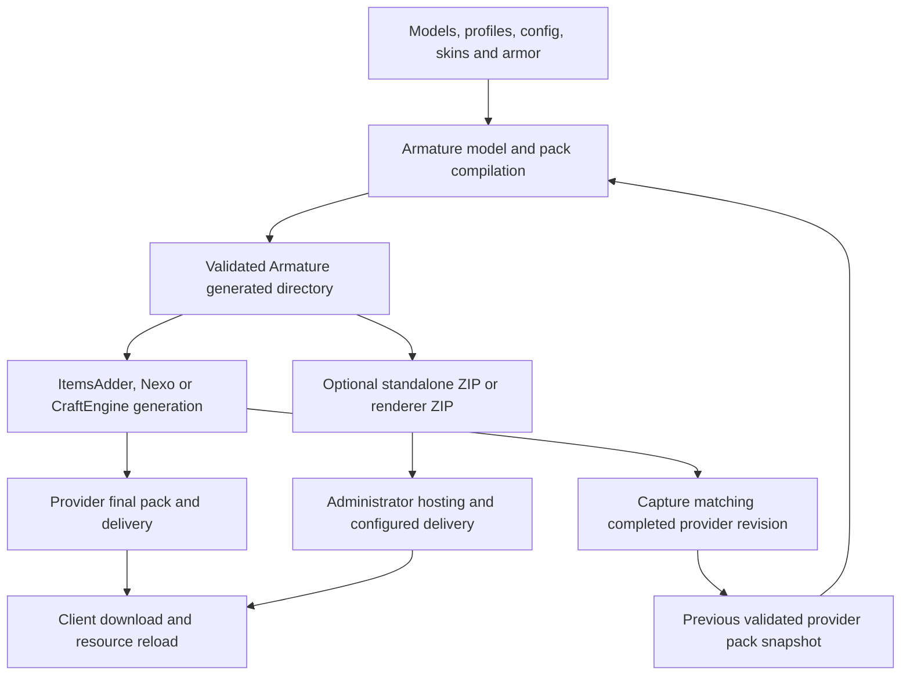

# Resource Packs

## From authored files to the downloaded pack



The model compiler reads your source assets and the last validated provider
snapshot. Armature publishes a generated directory. The external provider
includes that directory during its own generation, produces a final pack, and
owns delivery. Armature captures the **completed** provider output for future
item-model resolution; a generation-start event is not a successful receipt.

Do not edit `internal/provider-packs/`: these are retained snapshots, not live
authoring inputs. Keep provider sources in the provider's documented directories.

## Generate and synchronize

1. Apply model/profile/config changes with `/armature reload all` or targeted
   commands. `/armature diagnostics pack rebuild` rebuilds Armature assets.
2. Run the provider's full pack generation workflow, for example
   `/ce reload all` with CraftEngine. Armature reload does not execute it for you.
3. Use `/armature diagnostics pack sync` when synchronizing newly completed
   provider output; inspect progress and completion diagnostics.
4. Deliver the **provider's final pack** and wait for the client's download and
   resource reload. Validate the actual downloaded assets in game.

The previous validated snapshot stays available during generation. Failed
candidates do not become successful completed revisions. Reuse compares the
Armature revision and provider inputs; changing provider resources can require
generation even when Armature models did not change.

## Standalone ZIP

`resource-pack.generate-zip: true` also writes the Armature ZIP. `zip.path`,
`zip.method` (`stored`/`deflated`) and compression level configure that ZIP only.
They do not rename, compress or send an external provider's final output.
Without a provider, host and deliver the generated ZIP using your server's pack
delivery configuration. Armature generation alone is not hosting.

## Optional split renderer pack

```yaml
resource-pack:
  renderer-pack:
    enabled: true
    url: "https://packs.example.com/armature/renderer_pack.zip?v={sha1}"
    prompt: "Armature server rendering"
```

Replace the example URL with your real hosting address. Host
`plugins/Armature/renderer_pack.zip`, enable the split, fully restart, regenerate
and publish both outputs. The provider keeps delivering the common pack
(custom items, sounds and other shared resources). Server-rendered presentations
need the renderer pack; the client mod can omit it while rendering a compatible
bundle locally. Switching back waits for the required renderer pack to be ready.

The URL is an input, not an upload destination. Updating the local ZIP does not
update your host; `{sha1}` can give each content revision a distinct URL.

## Collisions and exclusions

`collision-policy` chooses deterministic ownership when normalized paths collide:
`keep-existing` keeps the first external owner, `replace` lets generated Armature
content win where involved, and `error` aborts the candidate. `collision-rules`
can scope policy by source, namespace and path.

`exclusions.sources`, `namespaces` and `paths` filter inputs to Armature generation.
They do not remove independently delivered assets from another provider's final
pack. Source and namespace IDs are normalized lowercase; paths use forward
slashes, `*` for one segment and `**` for multiple segments. Optimization
exclusions only disable optimization; they do not exclude the asset itself.

## Validation, optimization and overlays

`validation.enable` enables model/texture/atlas checks. `fail-on-error` controls
candidate rejection; inspect warnings even when it is false. JSON and PNG
optimization are opt-in and have their own exclusion lists.
`supported-version.min/max` selects bundled overlays; it does not translate
arbitrary models, install a client mod for another version, or extend the server API.

Provider `pack.mcmeta` and applicable overlays are retained during integration.
Only overlays active for the running Minecraft version participate in item
resolution. Shader/path collisions depend on the final provider merge, so test
with other packs enabled.

## Diagnose delivery

Compare input model/config revision, Armature generated output, provider
completion receipt/final ZIP, hosted content hash and client download. A correct
compiler result can still be absent from the final provider pack or the client's
cached ZIP. See the individual [provider pages](../advanced/supported-plugins/README.md).
