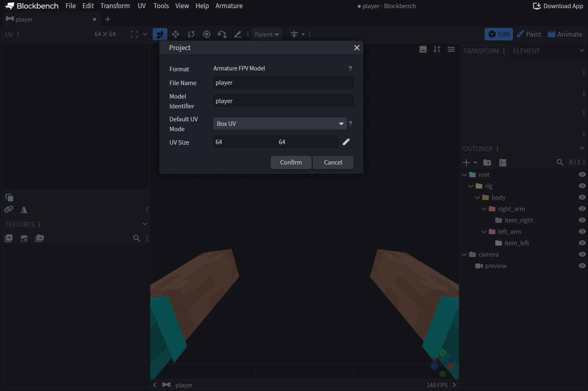
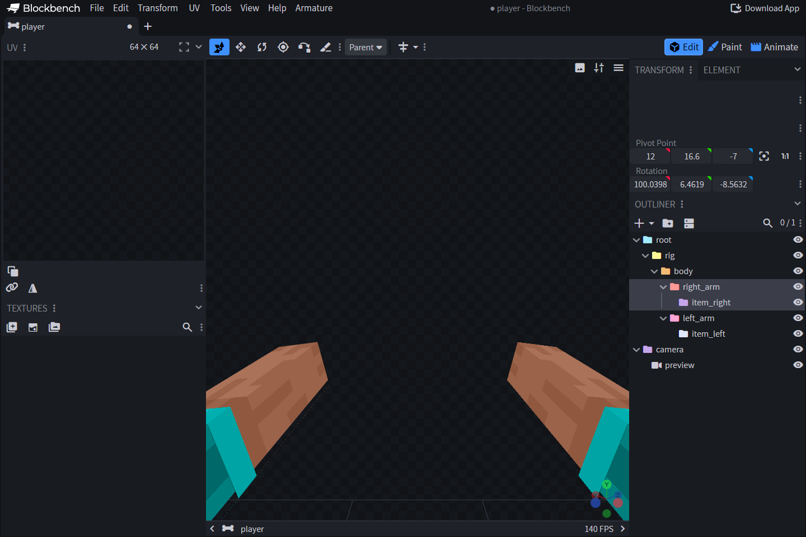

# Creating Your First Model

Install [the Armature extension](models/installing-plugin.md) and the official
Cameras plugin before starting. This tutorial uses explicit roles in `.armature`
v2; ordinary bone names do not select player limbs or held items.

[Download the tutorial model](../.gitbook/assets/examples/wiki_player.armature)
to inspect a working strict v2 source. It was saved through the current codec
from the supplied rig, with `base`, a short `inspect`, demonstration `aim`/`block`
clips and a `charm_socket`. The steps below show how to author your own model.



## 1. Create the project

Create **Armature FPV Model**. The supplied `default-v2` rig is initialized with
name/ID **player**, authored body/item pivots and the preview camera. Save a new
copy as `wiki_player.armature` rather than replacing your original rig.

## 2. Inspect roles and hierarchy

Right-click a bone and choose **Armature → Assign Role**. Keep a complete or
articulated arm role for each limb you want. Use `item_right`/`item_left` on
the corresponding item attachment bones. The scene can contain a single `camera`
role. Rename bones to meaningful project names without changing their role.

Add custom weapon/body geometry as ordinary authored cubes. Player-body preview
meshes are virtual: do not export extra skin cubes to imitate them. See
[Bone roles](models/bone-roles.md) for complete limbs, joints and generated skin.



## 3. Preview the held item

Use **Armature → Preview → Preview Items…** to choose a main/offhand item.
Use **Preview Assets** for a custom resource-pack ZIP. These meshes are editor
previews, not item IDs saved as gameplay configuration.

## 4. Author a short animation

In Animate mode, create `inspect`, add rotation keyframes to the desired arm
at 0 and 0.5 seconds, then return it to rest at 1 second. Keep the camera rest
rotation zero. Use small bone rotations first so pivots/alignment are easy to check.
Create a `base` loop if you want an authored idle pose, or leave movement rules
out and use the model's rest pose. Native names do not cause automatic playback.

For left-hand use, author the left bones/clips explicitly. `.armature` v2 does
not generate a mirrored animation. [Animations](models/animations-molang.md)
explains interpolation and Molang.

## 5. Save and use it

Save with **File → Save / Save As** or the normal shortcut. Reopen the file and
verify roles, Physics properties, geometry and clips. Copy it to
`plugins/Armature/models/wiki_player.armature`, then save this profile:

```yaml
wiki_player:
  match:
    item: minecraft:stick
  model:
    name: wiki_player
    hide-vanilla-hand: true
  animations:
    actions:
      - trigger: player:attack
        animation: inspect
```

Run `/armature reload all`, regenerate/deliver the provider's final pack, and
hold a stick in first person. An attack should play `inspect`. Ensure no other
enabled profile matches the same tutorial item. The model is now usable without
installing BetterModel or the optional client mod.

Continue with [Saving & deploying](models/saving-deploying.md) and
[Profile structure](profiles/README.md).
