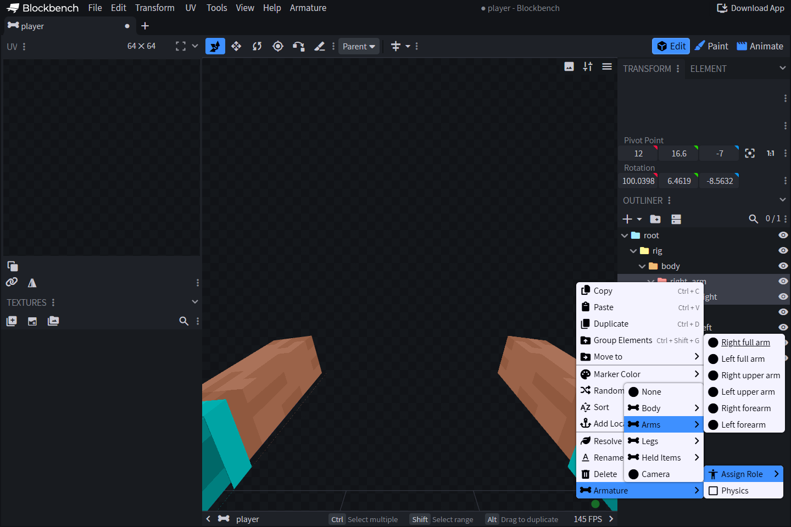

# 🦴 Bone Roles & Player Body

| Role | Meaning |
| --- | --- |
| `none` | Ordinary authored geometry only; default when absent |
| `head`, `body` | Head and torso |
| `right_full_arm`, `left_full_arm` | Rigid complete arm |
| `right_arm`, `left_arm` | Upper arm |
| `right_forearm`, `left_forearm` | Lower arm, including hand |
| `right_full_leg`, `left_full_leg` | Rigid complete leg |
| `right_thigh`, `left_thigh` | Upper leg |
| `right_lower_leg`, `left_lower_leg` | Lower leg, including foot |
| `item_right`, `item_left` | Player's held main/offhand item |
| `camera` | Viewport camera bone; at most one per document |

`armature_physics` is an independent boolean, default `false`, combinable with any role. Existing native physics configuration still controls simulation. Blockbench previews do not simulate physics.

Physics bones can form chains in the outliner. Enable `armature_physics` on each simulated segment (or use `phy_` names in legacy `.bbmodel`). Parents are evaluated first; each child springs toward the remaining tilt after the physics inherited from its ancestors, so camera compensation does not multiply with chain length. Each segment retains its own spring state for secondary motion during acceleration, turning and return to rest. Unflagged intermediate bones still transmit ancestor physics, including rotations from their authored pose, animation and ordinary additive layers. This remains a damped presentation effect without collision or rigid-body simulation.

Names never select roles or physics in v2. An unassigned bone named `pra_right_arm`, `pri_weapon`, `camera` or `phy_weapon` remains ordinary geometry. Names remain available to profile/effect targeting; UUIDs carry internal identity. Body/item roles may be duplicated, including overlapping full and segmented parts. Authors control overlap and visibility.

## Assign and duplicate

Right-click a bone → **Armature → Assign Role**. Role and Physics values survive
Undo/Redo, duplication and copy/paste. Body/item roles may be assigned to several
bones; only one camera is allowed. Missing role means `none`; missing Physics
means `false`. Bone names beginning `__armature_` are reserved for generated nodes.

## Pivots and body geometry

Start with the supplied rig: shoulder pivots belong to arms, elbow pivots to
forearms, hip pivots to thighs and knee pivots to lower legs. Complete limbs are
rigid 12-pixel meshes; articulated roles split at the joint. Generated geometry
uses the native body descriptor and its 0.9375 presentation scale.

Player skin and second-layer preview meshes follow the bones without entering
the project's cube/texture lists. The runtime uses the actual player's classic
or slim skin. Authored cubes remain exported with the bone; add decorative
geometry only when you intend it to coexist with the generated body.

## Held items and camera

Parent item-role bones to the arm/hand hierarchy and align their pivots in preview.
One preview item is attached to every bone assigned to that slot. Runtime
items come from the player's actual inventory presentation policy.

Keep the native camera bone's rest rotation `[0, 0, 0]`. Animate small offsets;
do not add fixed ItemDisplay half-turn compensation. The preview camera element
is editor-only. Roles are independent of names: calling a bone `camera` without
assigning its role does not create a runtime camera.

## Check in game

Verify classic/slim width, skin sleeves, both hand positions, bent joints and
equipped armor using the final downloaded pack. Preview meshes do not establish
client armor or shader compatibility. See [Skins & armor](../../advanced/custom-armors.md).
