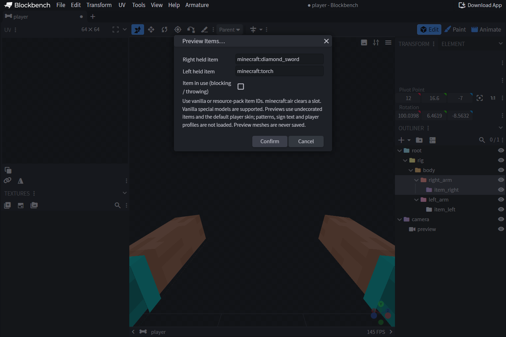

# Item & Resource-pack Previews

## Choose an item

Open **Armature → Preview → Preview Items…**. Enter a vanilla or custom pack
item ID for each hand. `minecraft:air` clears that slot. The selected object
appears on every bone with the matching item role and follows its animation.
**Clear Item Previews** clears those objects while retaining body previews.

Previews use third-person right/left-hand display transforms, matching the
native held-item attachment convention. Do not compensate with another fixed
half-turn in editor space.

## Load custom assets

Use **Armature → Preview Assets** to load a resource-pack ZIP or return to
official Minecraft assets. The ZIP needs `pack.mcmeta` and `assets/` at its root.
Custom files override official files; missing parents/textures fall back to the
base where possible. The official preview base is Minecraft **1.21.8** even when
your eventual Minecraft client uses another release.

The resolver handles supported item-model branches, generated sprites,
transparent contour walls, cuboid UVs and composite models. Vanilla special
models include shield, trident, chest, shulker, banners, heads, signs and other
1.21.8 special renderers. The **using item** control selects blocking/throwing
preview states where the model definition uses them.

## Preview boundaries

Preview IDs contain no full ItemStack components: banner/shield patterns, pot
decorations, sign text and custom player-head skins are not reconstructed from
an ID. Arbitrary dynamic properties, animated textures and overlay directories
are not guessed; unsupported branches produce a diagnostic.

Item/body meshes are editor-only and never serialized as your project geometry.
Item previews clear when switching projects or unloading the extension.
Pack preview is not pack delivery: after saving, test the provider's actual final
pack in game. Check IDs, parent chains and texture paths when a preview is absent.
