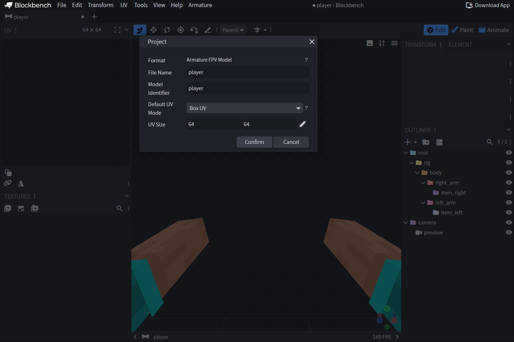
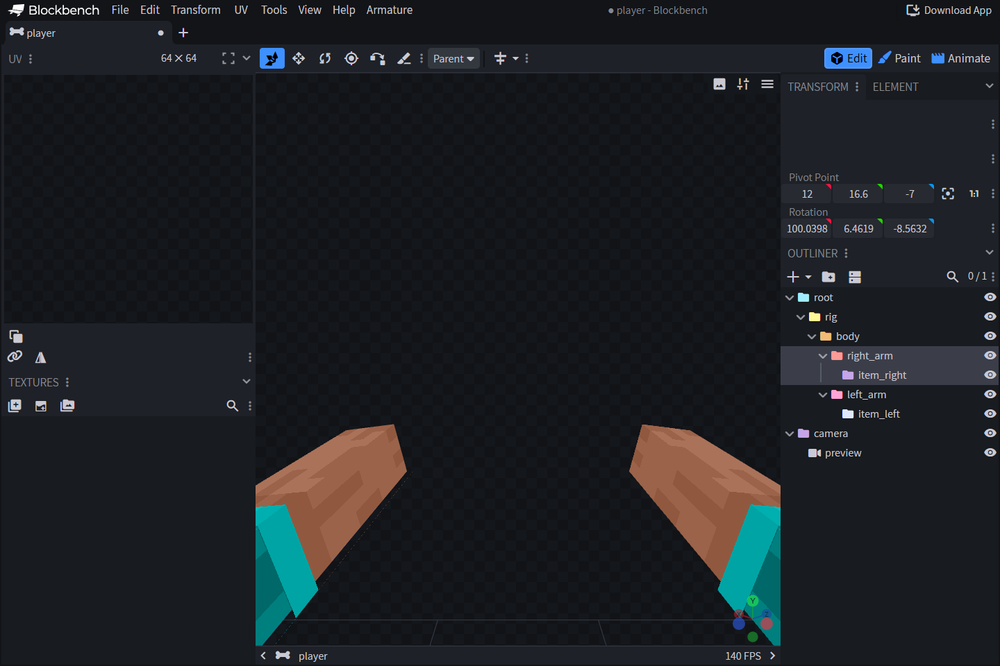

# 🧱 Создание первой модели

Установите [расширение Armature](modeli/installing-plugin.md) и официальный
плагин **Cameras**. В этом руководстве используются явные роли формата
`.armature` v2. Назначьте кости роль, чтобы связать её с частью тела или
предметом в руке.

[Скачайте модель из примера](../.gitbook/assets/examples/wiki_player.armature)
в строгом формате v2. В ней есть стандартный скелет, клипы `base`, `inspect`,
`aim` и `block`, а также точка крепления `charm_socket`.



## 1. Создайте проект

Создайте проект **Armature FPV Model**. Blockbench откроет скелет
`default-v2` с именем и идентификатором **player**, заданными точками
вращения тела и предметов, а также камерой предпросмотра. Сохраните копию
как `wiki_player.armature`, чтобы сохранить исходный скелет.

## 2. Проверьте роли и иерархию

Щёлкните кость правой кнопкой мыши и выберите **Armature → Assign Role**.
Для каждой отображаемой руки сохраните роль целой руки или роли её
сегментов. Назначьте `item_right` и `item_left` костям, к которым
крепятся соответствующие предметы. В сцене допускается одна роль `camera`.
Переименовывайте кости по своему усмотрению. Назначенные роли сохранятся.

Добавляйте собственную геометрию оружия и тела обычными кубами. Модель
тела в окне предпросмотра создаётся автоматически. Дополнительные кубы
для скина при экспорте не нужны. Подробнее о конечностях, суставах и
генерации скина см. [роли костей](modeli/bone-roles.md).



## 3. Проверьте предмет в руке

Откройте **Armature → Preview → Preview Items…** и выберите предмет для
основной или второй руки. Чтобы загрузить пакет ресурсов в ZIP, используйте
**Preview Assets**. Эти модели видны в редакторе. Идентификаторы предметов
для игры задаются отдельно в профиле.

## 4. Создайте короткую анимацию

Перейдите в режим **Animate** и создайте клип `inspect`. Добавьте ключевые
кадры вращения руки в моменты 0 и 0,5 секунды, а в момент 1 секунды верните
её в исходную позу. Оставьте нулевое вращение камеры в исходной позе.
Начните с небольших поворотов костей, чтобы проверить точки вращения и
выравнивание.

Для собственной позы ожидания создайте цикл `base`. Если правила движения
отсутствуют, используется исходная поза модели. Чтобы воспроизвести клип,
привяжите его к правилу профиля.

Для левой руки подготовьте соответствующие кости и клипы. Формат
`.armature` v2 не создаёт зеркальную анимацию автоматически. Интерполяция
и Molang описаны в [руководстве по анимациям](modeli/animations-molang.md).

## 5. Сохраните модель и проверьте её в игре

Сохраните проект через **File → Save / Save As** или обычным сочетанием
клавиш. Откройте файл заново и проверьте роли, свойства **Physics**,
геометрию и клипы. Скопируйте файл в
`plugins/Armature/models/wiki_player.armature` и сохраните этот профиль.

```yaml
wiki_player:
  match:
    item: minecraft:stick
  model:
    name: wiki_player
    hide-vanilla-hand: true
  animations:
    actions:
      - trigger: player:attack
        animation: inspect
```

Выполните `/armature reload all`, пересоберите и передайте игрокам итоговый
пакет ресурсов. Возьмите палку в режиме от первого лица. При атаке должен
воспроизводиться `inspect`. Убедитесь, что палка не подходит под другой
активный профиль. Для этой модели BetterModel и клиентский мод не требуются.

## Импорт из TACZ и Punchy

На стартовом экране Blockbench Desktop откройте категорию **Armature**.
Используйте сборку расширения Armature, в которой доступны команды импорта.

- **TACZ to Armature** импортирует оружие из JAR-файла мода TACZ или
  ZIP-архива с пакетом оружия. Если пакет зависит от мода, выберите оба
  файла одновременно. При совпадении файлов приоритет у ресурсов из ZIP.
  Если Blockbench предложит выбор, укажите оружие. Проект включает
  геометрию оружия, текстуру, руки игрока, нативную камеру и поддерживаемые
  клипы анимации Bedrock.
- **Punchy to Armature** импортирует дорожки анимаций от первого лица из
  JAR-файла Punchy или ZIP-архива с пакетом ресурсов. Дорожки можно
  редактировать в проекте игрока Armature. Правила мода, флаги временной
  шкалы, звуки и геометрия пользовательских предметов в импорт не входят.

Проверьте в Blockbench позы, камеру и положение предметов. Сохраните проект
в формате `.armature` v2 и привяжите нужные клипы к профилю Armature.

Далее см. [сохранение и установку моделей](modeli/saving-deploying.md)
и [структуру профилей](profili/README.md).
