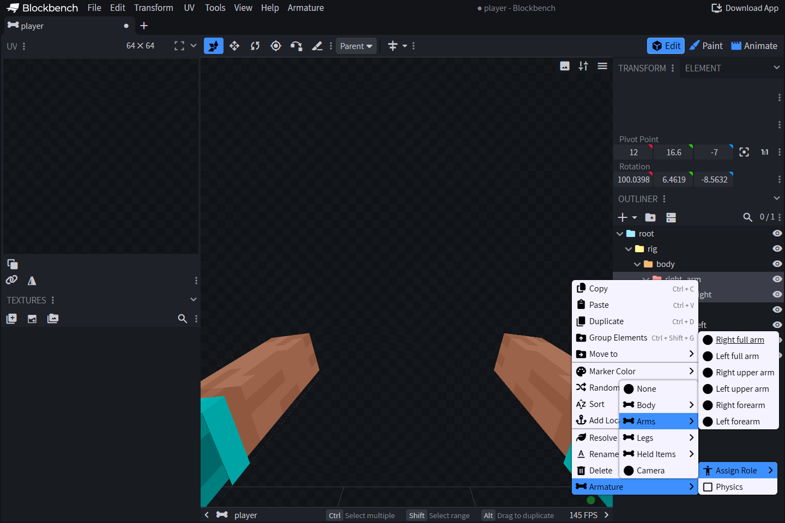

# 🦴 Роли костей и тело игрока

| Роль | Значение |
| --- | --- |
| `none` | Обычная авторская геометрия только. По умолчанию, если отсутствует |
| `head`, `body` | Голова и торс |
| `right_full_arm`, `left_full_arm` | Жесткая полная рука |
| `right_arm`, `left_arm` | Верхняя часть руки |
| `right_forearm`, `left_forearm` | Нижняя часть руки, включая кисть |
| `right_full_leg`, `left_full_leg` | Жесткая полная нога |
| `right_thigh`, `left_thigh` | Верхняя часть ноги |
| `right_lower_leg`, `left_lower_leg` | Нижняя часть ноги, включая стопу |
| `item_right`, `item_left` | Предмет в руке игрока (основная/вторая рука) |
| `camera` | Кость камеры обзора. Максимум одна на документ |

`armature_physics` — независимый булево значение, по умолчанию `false`, комбинируется с любой ролью. Существующая конфигурация нативной физики продолжает управлять симуляцией. Предварительный просмотр Blockbench не симулирует физику.

Кости физики могут образовывать цепи в выносе. Включите `armature_physics` на каждом сегменте симуляции (или используйте `phy_` в наследуемых `.bbmodel`). Родители оцениваются первыми. Каждый ребенок пружинит к оставленному наклону после наследуемой физики от предков, поэтому компенсация камеры не умножается на длину цепи. Каждый сегмент сохраняет свое состояние пружины для вторичного движения во время ускорения, поворота и возврата в покое. Не помеченные промежуточные кости все еще передают физику предков, включая повороты из авторского позы, анимации и обычных аддитивных слоев. Это остается эффектом с затуханием без столкновений или жестко-телесной симуляции.

Имена никогда не выбирают роли или физику в v2. Не назначенная кость с именем `pra_right_arm`, `pri_weapon`, `camera` или `phy_weapon` остается обычной геометрией. Имена остаются доступными для целевой настройки профиля/эффекта. UUID несут внутреннюю идентичность. Роли тела/предмета могут дублироваться, включая перекрывающиеся полные и сегментированные части. Авторы контролируют перекрытие и видимость.

## Назначить и дублировать

Нажмите правой кнопкой мыши по кости → **Armature → Assign Role**. Значения ролей и физики сохраняются после отмены/повторения, дублирования и копирования/вставки. Роли тела/предмета могут назначаться нескольким костям. Разрешено только одно изображение камеры. Отсутствие роли означает `none`. Отсутствие физики означает `false`. Названия костей, начинающиеся с `__armature_`, зарезервированы для генерируемых узлов.

## Центры вращения и геометрия тела

Начните с предоставленного скелета: центры вращения плеч принадлежат рукам, центры вращения локтей — предплечьям, центры вращения тазовых суставов — бедренным костям, а центры вращения коленных суставов — голени. Полные конечности представляют собой жесткие сетки из 12 пикселей. Роли с суставами разделяются в этих точках. Генерируемая геометрия использует описатель тела нативного движка и масштаб представления 0.9375.

Кожный рисунок игрока и сетки предпросмотра второго слоя следуют за костями, не входя в списки кубов/текстур проекта. Временная часть использует фактический классический или узкий кожный рисунок игрока. Авторские кубы остаются экспортируемыми вместе с костью. Добавляйте декоративную геометрию только если вы планируете, чтобы она сосуществовала с генерируемым телом.

## Предметы в руке и камера

Свяжите кости с ролями предметов к иерархии руки/ладони и выровняйте их центры вращения в предпросмотре. К каждой кости, назначенной этому слоту, прикрепляется один элемент предпросмотра. Предметы во время работы берутся из фактической политики представления инвентаря игрока.

Сохраните исходное вращение кости камеры нативного движка `[0, 0, 0]`. Анимировать небольшие смещения. Не добавлять фиксированную компенсацию полувращения ItemDisplay. Элемент камеры предпросмотра предназначен только для редактора. Роли независимы от названий: вызов кости `camera` без назначения ей роли не создаст камеру во время работы.

## Проверить в игре

Проверьте ширину классической/узкой модели, рукава скина, положение обеих рук, согнутые суставы и экипировку брони, используя скачанный пакет ресурсов. Предварительные сетки не определяют броню клиента или совместимость с шейдерами. См. [Скины и броня](../../rasshirennye-vozmozhnosti/polzovatelskaya-bronya.md).
