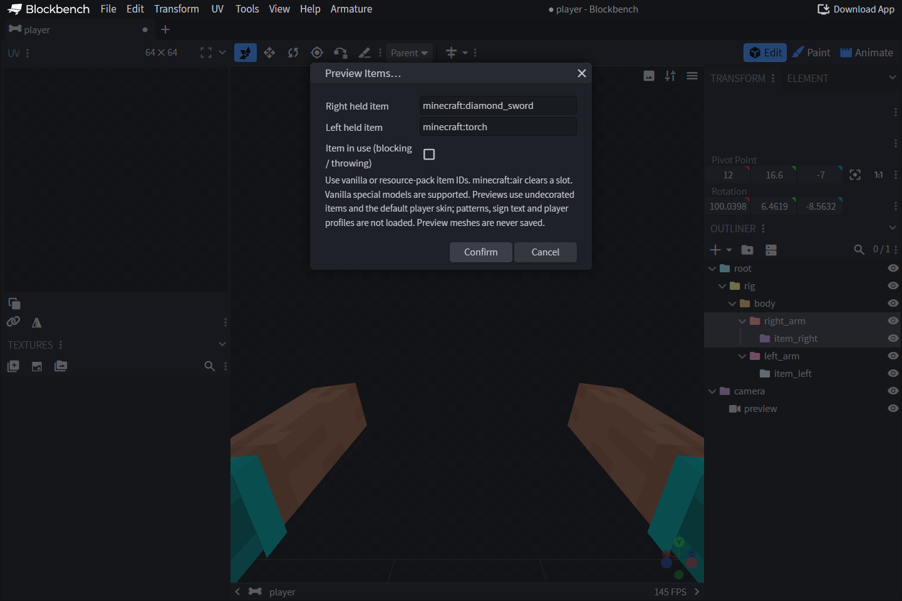

# 🔎 Предпросмотр предметов и пакетов ресурсов

## Выбор предмета

Откройте **Armature → Preview → Preview Items…** и введите идентификатор
предмета для каждой руки. Можно указать стандартный предмет или предмет
из пользовательского пакета. Значение `minecraft:air` очищает ячейку.
Предмет появляется на каждой кости с соответствующей ролью и следует её
анимации. Команда **Clear Item Previews** убирает предметы, сохраняя
предпросмотр тела.

Для предпросмотра используются трансформации предметов в правой и левой
руке от третьего лица, как при их креплении в нативном движке. Дополнительный
поворот на 180 градусов в редакторе не нужен.

## Загрузка пользовательских ресурсов

Используйте **Armature → Preview Assets**, чтобы загрузить пакет ресурсов
в ZIP или вернуться к официальным ресурсам Minecraft. В корне ZIP должны
находиться `pack.mcmeta` и `assets/`. Пользовательские файлы имеют
приоритет. Если родительская модель или текстура отсутствует, по возможности
используется файл из официальных ресурсов. В основе предпросмотра лежат
ресурсы **Minecraft 1.21.8**, даже если для игры используется другая версия.

Расширение обрабатывает поддерживаемые ветви моделей предметов, созданные
спрайты, боковые грани по контуру прозрачности, UV-развёртки кубоидов
и составные модели. Среди специальных моделей версии 1.21.8 есть щиты,
трезубцы, сундуки, шалкеровые ящики, флаги, головы и таблички. Параметр
**using item** показывает состояния блокирования или броска, если они
заданы в модели.

## Ограничения предпросмотра

Идентификатор предмета не содержит полный набор компонентов ItemStack.
По одному идентификатору нельзя восстановить узоры флага или щита,
украшения горшка, текст таблички или скин головы игрока. Произвольные
динамические свойства, анимированные текстуры и каталоги оверлеев
не поддерживаются. Для неподдерживаемых ветвей выводится диагностика.

Геометрия предпросмотра предметов и тела используется только в редакторе
и не сохраняется в модели. Предметы очищаются при смене проекта или
отключении расширения. После сохранения проверьте в игре итоговый пакет,
который доставляет провайдер. Если предмет не появился в предпросмотре,
проверьте идентификаторы, цепочку родительских моделей и пути к текстурам.
