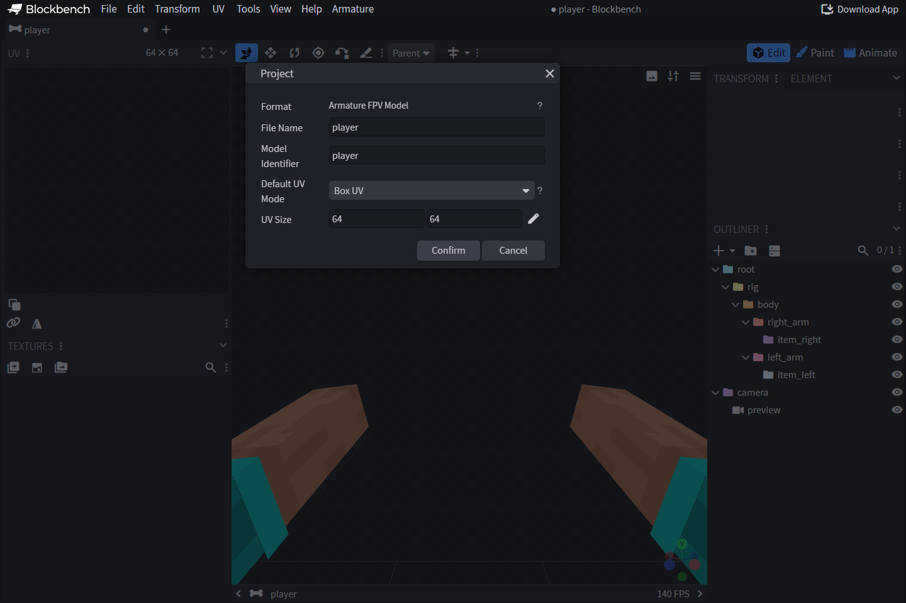
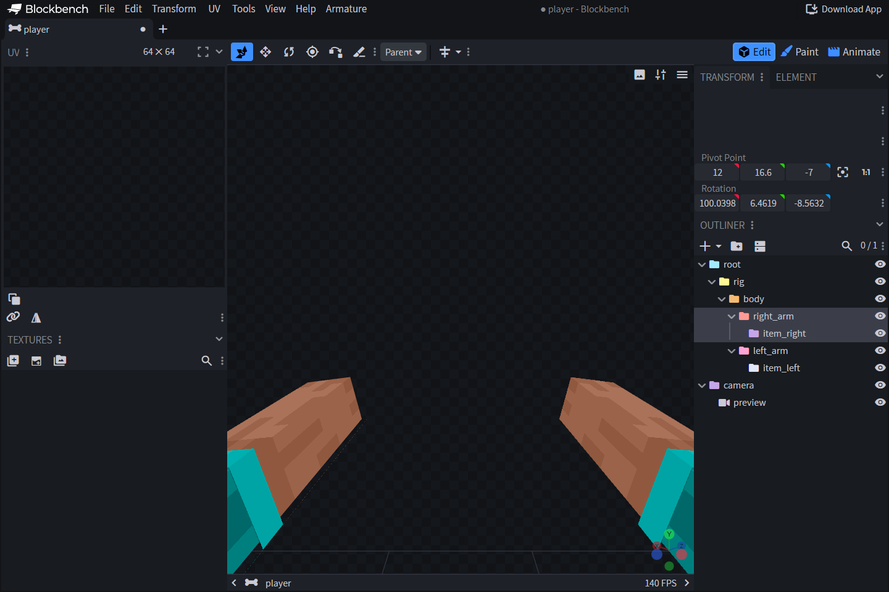

# 🧱 Créer votre premier modèle

Installez [l’extension Armature](modeles/installing-plugin.md) et le plugin
officiel **Cameras**. Ce guide utilise les rôles explicites du format
`.armature` v2. Pour associer un os à un membre ou à un objet tenu, attribuez
un rôle à cet os.

[Téléchargez le modèle du tutoriel](../.gitbook/assets/examples/wiki_player.armature)
pour examiner un exemple au format strict v2. Ce modèle utilise le squelette
fourni et contient `base`, un court clip `inspect`, des exemples de clips
`aim` et `block` et un point d’attache `charm_socket`.



## 1. Créer le projet

Créez un projet **Armature FPV Model**. Blockbench ouvre le squelette fourni
`default-v2` avec **player** comme nom et identifiant, les pivots du corps et des
objets, et la caméra d’aperçu. Enregistrez une copie sous
`wiki_player.armature` pour conserver le squelette d’origine.

## 2. Examiner les rôles et la hiérarchie

Faites un clic droit sur un os et choisissez **Armature → Assign Role**.
Gardez un rôle de bras entier ou articulé pour chaque membre à afficher.
Attribuez `item_right` ou `item_left` à l’os qui porte l’objet de la main
correspondante. La scène accepte un seul rôle `camera`. Renommez les os selon
les besoins du projet. Le rôle reste associé à l’os.

Ajoutez les éléments personnalisés du corps ou de l’arme sous forme de cubes.
L’aperçu du corps du joueur est virtuel. Évitez d’ajouter des cubes de skin à
exporter. Consultez les [rôles des os](modeles/bone-roles.md) pour les membres,
les articulations et la génération du skin.



## 3. Prévisualiser l’objet tenu

Utilisez **Armature → Preview → Preview Items…** pour choisir un objet pour la
main principale ou secondaire. Utilisez **Preview Assets** pour charger un
pack de ressources ZIP. La sélection reste dans l’éditeur et ne définit
aucun identifiant d’objet en jeu.

## 4. Créer une animation courte

Dans le mode **Animate**, créez `inspect`. Ajoutez des images clés de rotation
au bras à 0 et 0,5 seconde, puis remettez-le au repos à 1 seconde. Laissez la
rotation de la caméra au repos à zéro. Commencez par de petites rotations
pour contrôler les pivots et l’alignement.

Pour personnaliser la pose d’attente, créez une boucle `base`. Vous pouvez
aussi omettre les règles de mouvement pour garder la pose de repos. Configurez
les règles qui lancent les clips dont vous avez besoin.

Pour utiliser la main gauche, animez ses os et préparez ses clips. Le format
`.armature` v2 ne génère aucun miroir automatique. Le [guide des animations](modeles/animations-molang.md)
explique l’interpolation et Molang.

## 5. Enregistrer et tester en jeu

Enregistrez avec **File → Save / Save As** ou le raccourci habituel. Rouvrez le
fichier et vérifiez les rôles, les propriétés **Physics**, la géométrie et les
clips. Copiez-le dans `plugins/Armature/models/wiki_player.armature`, puis
enregistrez ce profil.

```yaml
wiki_player:
  match:
    item: minecraft:stick
  model:
    name: wiki_player
    hide-vanilla-hand: true
  animations:
    actions:
      - trigger: player:attack
        animation: inspect
```

Exécutez `/armature reload all`, régénérez et distribuez le pack de ressources
final, puis tenez un bâton en vue à la première personne. Une attaque doit
lancer `inspect`. Assurez-vous qu’aucun autre profil activé ne correspond au
bâton. Ce modèle fonctionne sans BetterModel ni le mod client facultatif.

## Importer depuis TACZ ou Punchy

Sur l’écran d’accueil de Blockbench Desktop, ouvrez la catégorie **Armature**.
Utilisez un build de l’extension Armature qui affiche les raccourcis d’import.

- **TACZ to Armature** importe une arme depuis le JAR du mod TACZ ou un pack
  d’armes ZIP. Sélectionnez les deux fichiers si le pack dépend du mod. Les
  ressources du ZIP remplacent celles du JAR lorsqu’elles correspondent.
  Sélectionnez l’arme si Blockbench le demande. Le projet contient sa
  géométrie, sa texture, les bras du joueur, la caméra native et les clips
  d’animation Bedrock pris en charge.
- **Punchy to Armature** importe les pistes d’animation à la première personne
  depuis un JAR Punchy ou un pack de ressources ZIP. Les pistes sont
  modifiables dans le projet Armature du joueur. Les règles du mod, les
  marqueurs de la timeline, les sons et la géométrie des objets personnalisés
  restent hors du périmètre de l’import.

Vérifiez les poses, la caméra et l’alignement des objets dans Blockbench.
Enregistrez le projet au format `.armature` v2 et associez les clips à un
profil Armature.

Poursuivez avec [l’enregistrement et le déploiement](modeles/saving-deploying.md)
et la [structure des profils](profils/README.md).
