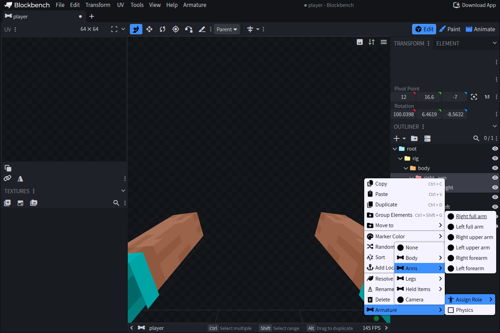

# 🦴 Rôles des os et corps du joueur

| Rôle | Signification |
| --- | --- |
| `none` | Géométrie autorisée uniquement par défaut. Valeur par défaut en l’absence de rôle |
| `head`, `body` | Tête et torse |
| `right_full_arm`, `left_full_arm` | Bras complet rigide |
| `right_arm`, `left_arm` | Bras supérieur |
| `right_forearm`, `left_forearm` | Bras inférieur, y compris la main |
| `right_full_leg`, `left_full_leg` | Jambe complète rigide |
| `right_thigh`, `left_thigh` | Cuisse |
| `right_lower_leg`, `left_lower_leg` | Jambe, y compris le pied |
| `item_right`, `item_left` | Objet tenu par le joueur dans la main principale ou secondaire |
| `camera` | Os de la caméra de la vue. Au plus un par document |

`armature_physics` est un booléen indépendant, valeur par défaut `false`, combinable avec n’importe quel rôle. La configuration physique native existante contrôle toujours la simulation. Les prévisualisations Blockbench ne simulent pas la physique.

Les os physiques peuvent former des chaînes dans l’outliner. Activez `armature_physics` sur chaque segment simulé (ou utilisez les noms `phy_` dans les `.bbmodel` hérités). Les parents sont évalués en premier. Chaque enfant s’incline vers le reste de la déviation après la physique héritée de ses ancêtres, de sorte que la compensation de la caméra ne se multiplie pas avec la longueur de la chaîne. Chaque segment conserve son propre état de ressort pour le mouvement secondaire pendant l’accélération, le virage et le retour au repos. Les os intermédiaires non flagués transmettent toujours la physique des ancêtres, y compris les rotations de leur pose autorisée, de l’animation et des couches additives ordinaires. Cela reste un effet de présentation amorti sans collision ou simulation de corps rigide.

Les noms ne sélectionnent jamais de rôles ou de physique dans la version 2. Un os non assigné nommé `pra_right_arm`, `pri_weapon`, `camera` ou `phy_weapon` reste une géométrie ordinaire. Les noms restent disponibles pour la ciblage de profil ou d’effets. Les UUID portent l’identité interne. Les rôles du corps ou de l’objet peuvent être dupliqués, y compris des parties complètes et segmentées qui se chevauchent. Les auteurs contrôlent le chevauchement et la visibilité.

## Assigner et dupliquer

Cliquez avec le bouton droit sur un os → **Armature → Assign Role**. Les valeurs de rôle et de physique survivent à l’annulation/la réannulation, à la duplication et au copier-coller. Les rôles du corps/objet peuvent être assignés à plusieurs os. Seule une caméra est autorisée. Un rôle manquant signifie `none`. Une physique manquant signifie `false`. Les noms d’os commençant par `__armature_` sont réservés aux nœuds générés.

## Centres de pivot et géométrie du corps

Commencez avec le squelette fourni : les pivots d’épaule appartiennent aux bras, les pivots de coude aux avant-bras, les pivots de hanche aux cuisses et les pivots de genou aux jambes inférieures. Les membres complets sont des maillages rigides de 12 pixels. Les rôles articulés se scindent au niveau de l’articulation. La géométrie générée utilise le descripteur de corps natif et son échelle de présentation 0.9375.

La peau du joueur et les maillages de prévisualisation de la deuxième couche suivent les os sans entrer dans les listes de cubes/textures du projet. Le temps d’exécution utilise la peau classique ou slim réelle du joueur. Les cubes créés restent exportés avec l’os. Ajoutez uniquement de la géométrie décorative si vous souhaitez qu’elle coexiste avec le corps généré.

## Objets tenus et caméra

Attachez les os du rôle d’objet parent à la hiérarchie bras/main et alignez leurs pivots en prévisualisation. Un objet de prévisualisation est attaché à chaque os assigné à cette case. Les objets du temps d’exécution proviennent de la politique de présentation d’inventaire réelle du joueur.

Gardez la rotation au repos de l’os de caméra natif `[0, 0, 0]`. Animez de petits décalages. N’ajoutez pas de compensation de demi-tour fixe ItemDisplay. L’élément de caméra de prévisualisation est exclusif à l’éditeur. Les rôles sont indépendants des noms : appeler un os `camera` sans lui assigner de rôle ne crée pas une caméra du temps d’exécution.

## Vérifier dans le jeu

Vérifiez la largeur classique/slim, les manches de la peau, les positions des deux mains, les articulations pliées et l’équipement de l’armure en utilisant le pack téléchargé final. Les maquettes prévisualisées ne définissent pas l’armure du client ni la compatibilité des shaders. Consultez [Peaux et armure](../../avance/armures-personnalisees.md).
