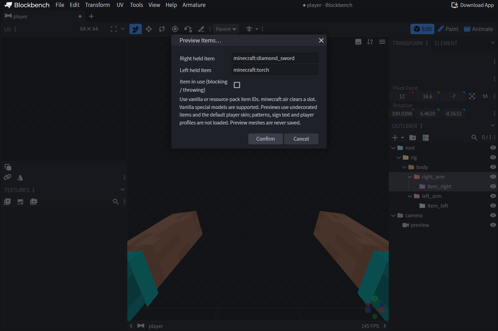

# 🔎 Aperçu des objets et packs de ressources

## Choisir un objet

Ouvrez **Armature → Preview → Preview Items…** et saisissez pour chaque main
un identifiant d’objet vanilla ou issu d’un pack personnalisé.
`minecraft:air` vide l’emplacement. L’objet apparaît sur chaque os dont
le rôle correspond et suit son animation. **Clear Item Previews** retire
ces objets tout en gardant l’aperçu du corps.

L’aperçu utilise les transformations des mains droite et gauche en vue à la
troisième personne, comme le moteur natif pour attacher les objets. Gardez
cette orientation dans l’éditeur.

## Charger des ressources personnalisées

Utilisez **Armature → Preview Assets** pour charger un pack de ressources ZIP
ou revenir aux ressources officielles de Minecraft. Placez `pack.mcmeta`
et `assets/` à la racine du ZIP. Les fichiers personnalisés priment.
L’extension utilise les modèles parents et les textures du pack officiel
pour les fichiers manquants quand c’est possible. L’aperçu repose sur les
ressources de **Minecraft 1.21.8**, quelle que soit la version utilisée
ensuite en jeu.

L’extension prend en charge les branches compatibles des modèles d’objet,
les sprites générés, les parois de contour selon la transparence, les UV des
cuboids et les modèles composites. Parmi les modèles spéciaux de la 1.21.8
figurent les boucliers, tridents, coffres, boîtes de Shulker, bannières,
têtes et panneaux. L’option **using item** prévisualise les états de blocage
ou de lancer quand le modèle les définit.

## Limites de l’aperçu

L’identifiant de l’objet ne fournit pas les composants complets de
l’ItemStack. Un identifiant seul ne suffit pas pour reconstruire les
motifs de bannière ou de bouclier, les décorations des pots, le texte des
panneaux ou le skin d’une tête de joueur. Les propriétés dynamiques
arbitraires, les textures animées et les répertoires d’overlay ne sont pas
pris en charge. Un diagnostic signale les branches non prises en charge.

Les maillages d’aperçu des objets et du corps restent dans l’éditeur.
Ils ne font pas partie de la géométrie enregistrée. Les objets d’aperçu
sont effacés au changement de projet ou à la désactivation de l’extension.
Après l’enregistrement, testez en jeu le pack final distribué par le
fournisseur. Si un aperçu manque, vérifiez les identifiants, les modèles
parents et les chemins des textures.
