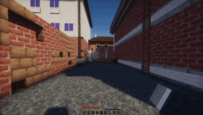
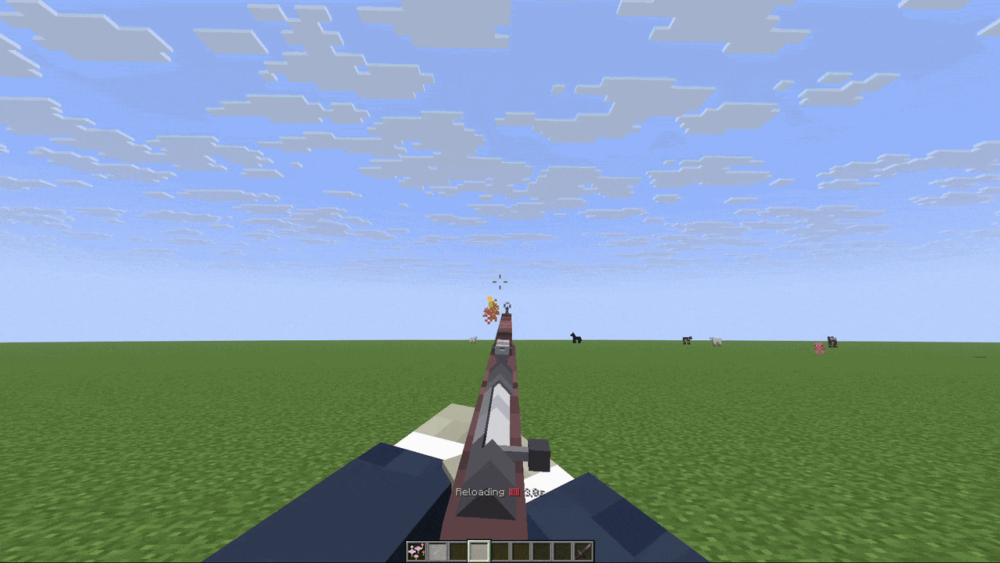

# 🔫 WeaponMechanics

Armature распознает WeaponMechanics как опционального поставщика предметов и действий. WeaponMechanics остается владельцем идентификации оружия, патронов, логики перезарядки, режима стрельбы, прицеливания, урона и задержек. Armature преобразует эти события в действия представления от первого лица и современные сигналы профиля.

Идентификатор поставщика и пространство имен: `weaponmechanics`.

<figure><figcaption></figcaption></figure>

## Современный профиль

Совместите заголовок WeaponMechanics с селектором предметов с пространством имен:

```yaml
m4a1:
  match:
    item: weaponmechanics:m4a1
  model:
    name: arm_rifle
    hide-vanilla-hand: true
  integrations:
    weaponmechanics:
      attachments:
        optic:
          bones:
            scope:
              visible: true
              offset: [0.0, 0.0, 0.0]
  animations:
    actions:
      - trigger: weaponmechanics:fire
        animation:
          name: fire
          duration: 4t
      - trigger: weaponmechanics:reload-start
        animation:
          name: reload
          duration: 20t
```

Селектор предметов WeaponMechanics — это название оружия, а не отображаемое имя. Поставщик излучает метаданные руки как `main_hand` или `off_hand`.

Опциональный раздел `integrations.weaponmechanics.attachments` содержит произвольные идентификаторы аксессуаров. Каждый аксессуар содержит только `bones`. Каждая кость принимает `visible` и `offset`. Смещение — либо список из трех чисел, либо раздел `x`/`y`/`z`:

```yaml
integrations:
  weaponmechanics:
    attachments:
      suppressor:
        bones:
          muzzle:
            visible: false
            offset:
              x: 0.0
              y: 0.0
              z: -0.1
```

## Действия и сигналы поставщика

Поставщик излучает следующие действия представления:

| Событие | Действие Armature | Сигнал с пространством имен |
| ------------------------- | ----------------------- | -------------------------------------------------- |
| Оружие оснащено | `EQUIP` | `weaponmechanics:equip` |
| Оружие снято | `UNEQUIP` | `weaponmechanics:unequip` |
| Введен прицел | `AIM_ENTER`, затем `AIM` | `weaponmechanics:aim-enter`, `weaponmechanics:aim` |
| Прицел остается наложенным | `AIM` | `weaponmechanics:aim` |
| Вышел из прицела | `AIM_EXIT` | `weaponmechanics:aim-exit` |
| Оружие выстрелено из бедра | `FIRE` | `weaponmechanics:fire` |
| Огонь оружия при прицеливании | `AIM_FIRE` | `weaponmechanics:aim-fire` |
| Ввод перезарядки | Только сигнал | `weaponmechanics:reload` |
| Начало цикла перезарядки | `RELOAD_START` | `weaponmechanics:reload-start` |
| Итерация перезарядки | `RELOAD_PHASE` | `weaponmechanics:reload-phase` |
| Перезарядка достигла емкости | `RELOAD_COMPLETE` | `weaponmechanics:reload-complete` |
| Перезарядка отменена | `RELOAD_CANCEL` | `weaponmechanics:reload-cancel` |
| Состояние огнестрельного оружия изменилось | `FIREARM_STATE` | `weaponmechanics:firearm-state-change` |
| Выборочный огонь изменился | `FIRE_MODE_CHANGE` | `weaponmechanics:fire-mode-change` |

Адаптер несет метаданные `main_hand`/`off_hand`. Проверьте руку, которую испускает ваша установленная версия WeaponMechanics. Не выводите её из клипа по имени.

`weaponmechanics:reload` отправляется на этапе ввода низкой приоритетности, до того как WeaponMechanics выполнит свой обычный путь перезарядки. Современное правило с `consume: true` отменяет событие перезарядки WeaponMechanics. Это единственный сигнал провайдера, который может предотвратить собственное игровое действие провайдера. Armature все еще не реализует логику перезарядки самостоятельно.

## Детали события

Каждое событие провайдера включает:

| Ключ | Значения |
| -------------- | ------------------------- |
| `weapon-title` | Заголовок WeaponMechanics |
| `hand` | `main_hand` или `off_hand` |

События охвата дополнительно включают `zoom`. Событие выхода включает `automatic-after-shot`. Armature добавляет `aiming=true` или `aiming=false` к соответствующему современному сигналу.

События стрельбы включают `aiming`.

Сигналы начала и фазы перезарядки включают:

| Ключ | Значение |
| --------------------------------------------------- | ---------------------------------------- |
| `cycle` | Идентификатор цикла перезарядки Armature. |
| `phase` | `load`. |
| `ammo`, `ammo-before`, `ammo-after` | Значения патронов для итерации. |
| `magazine-size` | Текущая вместимость магазина. |
| `initial-ammo`, `initial-magazine-size` | Значения в начале цикла. |
| `ammo-per-reload` | Количество патронов, загружаемых за итерацию. |
| `round-index` | Однозначная итерация перезарядки. |
| `rounds-needed`, `rounds-added`, `rounds-remaining` | Прогресс цикла. |
| `final-round` | Достигает ли эта итерация вместимости. |
| `reload-mode` | `per-round` или `bulk`. |
| `reload-ticks`, `ammo-load-ticks` | Времена перезарядки WeaponMechanics. |
| `firearm-open-ticks`, `firearm-close-ticks` | Времена перехода огнестрельного оружия. |
| `firearm-type` | Нормализованный тип огнестрельного оружия WeaponMechanics. |

Отчеты о завершении перезарядки включают `cycle`, `rounds-needed`, `rounds-remaining=0` и `final-round=true`. WeaponMechanics может отправить событие завершения после каждой итерации `Ammo_Per_Reload`. Armature отправляет `RELOAD_COMPLETE` только когда магазин действительно достигает вместимости.

Отмены перезарядки включают `elapsed-ticks` и, если существует отслеживаемый цикл, `cycle`, `rounds-needed` и `rounds-remaining`.

Сигналы состояния огнестрельного оружия включают: `state`, `firearm-state`, `phase`, `context` (`firearm`, `reload` или `shot`), `firearm-type`, `time`, `firearm-ticks`, `firearm-open-ticks` и `firearm-close-ticks`.

Сигналы режима огня включают `mode`, `fire-mode`, `old-mode`, `new-mode`, `old-selective-fire` и `new-selective-fire`.

<figure><figcaption><p>Пример действия затвора огнестрельного оружия с перезагрузкой.</p></figcaption></figure>

## Условия и примеры

Используйте значения провайдера в современных условиях. Значения правой руки требуют префикса `$`:

```yaml
animations:
  actions:
    - trigger: weaponmechanics:fire
      condition:
        all:
          - weaponmechanics.ammo > 0
          - weaponmechanics.ammo == $weaponmechanics:magazine-size
      animation:
        name: fire
        duration: 4t
```

Пространство имен провайдера также доступно интеграциям через API представления. Оно не делает игровой состояние изменяемым из конфигурации Armature.

Для полного списка встроенных полей см. [Встроенные условия](../../nachalo-raboty/profili/conditions.md) и [Встроенные триггеры](../../nachalo-raboty/profili/triggers.md).


## Проверьте полный путь оружия

Заголовок примера `m4a1`, идентификаторы аксессуаров и кости модели должны существовать в ваших собственных определениях оружия/модели. `arm_rifle` должен обеспечивать `fire` и `reload`. Добавьте правило движения `base` для постоянного положения отдыха. Перезагрузите профили, соберите и доставьте финальный пакет, затем протестируйте выстрел в упор, прицельный выстрел, начало перезарядки, каждую фазу по очереди, завершение емкости, отмену и обе руки.

Переопределение прикрепления кости WeaponMechanics отдельно от переразрушаемых [`type: attachment` составных профилей](../../nachalo-raboty/profili/attachments.md). Оно изменяет настроенные кости. Оно не определяет переразружаемую смонтированную модель.
